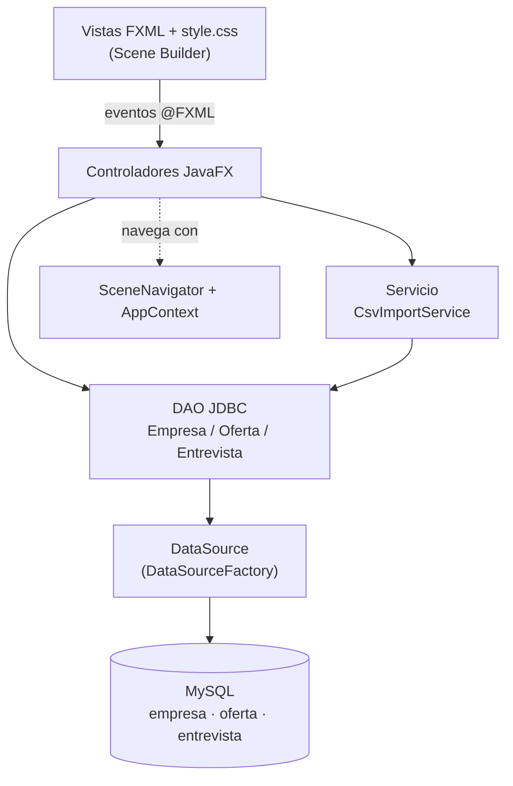
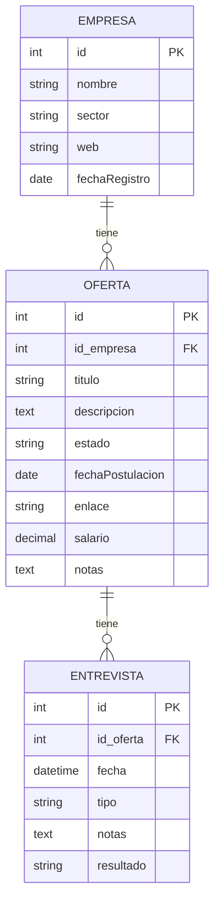

# EjercicioIntegradorT1 v2.0 — Trackly (JDBC + JavaFX)

Aplicación de escritorio para llevar el seguimiento de **candidaturas de empleo**: ofertas, empresas y entrevistas. Es la **versión 2.0** del proyecto: la v1 era una aplicación de consola que guardaba los datos en un fichero CSV; la v2 migra la persistencia a **JDBC con MySQL** y sustituye la consola por una **interfaz gráfica JavaFX** diseñada con Scene Builder.

- **Repositorio:** https://github.com/romanickCF/EjercicioIntegradorV2

## Equipo y reparto de roles

| Miembro | Rol | Responsabilidades |
|---|---|---|
| **Romanick Raga** | Acceso a datos y lógica de la aplicación | Esquema de base de datos (`schema.sql`), configuración de la conexión, modelos, capa DAO con JDBC, servicio de importación del CSV, transacciones, controladores JavaFX, navegación entre pantallas y este README |
| **Diego Miguel Benitez** | Interfaces | Creación y diseño de las vistas FXML con Scene Builder, hoja de estilos (`style.css`) y diseño visual «Trackly» (barra lateral, cabecera, botones y tablas) |

> **Reparto práctico:** Diego crea y maqueta las vistas FXML y la hoja de estilos; Romanick implementa la lógica de eventos de los controladores que enlazan esas vistas con la capa de datos.

## Tecnologías

| Tecnología | Uso |
|---|---|
| Java (JDK 27, según `pom.xml`) | Lenguaje, con módulos (`module-info.java`) |
| JavaFX 21.0.6 + FXML + Scene Builder | Interfaz gráfica |
| MySQL 8 + JDBC (`mysql-connector-j`) | Persistencia |
| Lombok | `@Data` en los modelos y `@RequiredArgsConstructor` en controladores y servicio |
| Maven (con *wrapper*) | Construcción y ejecución |
| JUnit 5 | Pruebas unitarias del modelo, los filtros y la importación del CSV |

> La persistencia se hace con **JDBC puro** (`PreparedStatement`, `try-with-resources`). No se usa ningún framework de mapeo: la dependencia de Hibernate se eliminó del `pom.xml`.

> **Compatibilidad:** el `pom.xml` fija `source`/`target` 27. Si compilas con otro JDK, ajusta esos valores (JDK 21 o 25 LTS son compatibles con JavaFX 21.0.6).

---

## Arquitectura

La aplicación sigue una arquitectura **por capas**, tomando como referencia el proyecto de ejemplo del profesor (`InventarioAppG1`). Cada capa solo conoce a la de debajo y las dependencias se **inyectan por constructor**.



### Estructura del proyecto

```
src/main
├── java/org/example/ejerciciointegrador
│   ├── Launcher.java            main(): lanza la aplicación JavaFX
│   ├── App.java                 start(): inicializa la BD, crea DAO/servicio y abre la 1ª pantalla
│   ├── models/                  Empresa, Oferta, Entrevista (POJOs con Lombok @Data)
│   ├── data/                    ← ACCESO A DATOS
│   │   ├── DAO<T>               interfaz genérica: findById, findAll, save, update, deleteById
│   │   ├── EmpresaJdbcDAO       implementación JDBC de empresas
│   │   ├── OfertaJdbcDAO        implementación JDBC de ofertas (JOIN con empresa y filtros)
│   │   ├── EntrevistaJdbcDAO    implementación JDBC de entrevistas
│   │   ├── FiltroOferta         criterios de búsqueda combinables (record)
│   │   ├── DataSourceFactory    singleton del DataSource; lee config.properties / variables de entorno
│   │   └── DataBaseInitializer  ejecuta schema.sql al arrancar
│   ├── service/
│   │   └── CsvImportService     importa el CSV inicial a la BD en una transacción
│   ├── common/
│   │   ├── SceneNavigator       carga FXML con FXMLLoader e inyecta los controladores
│   │   ├── AppContext           singleton para pasar datos entre pantallas
│   │   └── Alertas              diálogos de información, error y confirmación
│   └── controllers/             ← INTERFACES (lógica de eventos)
│       ├── OfertasController, OfertaDetailController, OfertaFormController
│       ├── EmpresasController, EmpresaFormController
│       └── EntrevistaFormController
└── resources
    ├── schema.sql               creación del esquema (versionado)
    ├── config.properties.example plantilla de conexión (sin credenciales reales)
    ├── config.properties        configuración local (ignorada por Git)
    └── org/example/ejerciciointegrador
        ├── style.css            hoja de estilos «Trackly»
        └── views/*.fxml         ← vistas diseñadas con Scene Builder

src/test
└── java/...                     pruebas JUnit 5 (modelo, filtros e importación CSV)

ejemplo-candidaturas.csv         CSV de prueba para el botón «Importar CSV»
```

### Capa de acceso a datos (`data/`, `service/`)

Responde al bloque **Acceso a Datos** del enunciado (criterios RA2):

- **Esquema en MySQL** con las tres tablas y sus relaciones (`schema.sql`).
- **Patrón DAO.** La interfaz genérica `DAO<T>` define el CRUD y cada entidad tiene su implementación JDBC. Todas las consultas usan `PreparedStatement` y `try-with-resources`, y los `SQLException` se envuelven en `RuntimeException`.
- **Consultas con `JOIN`.** `OfertaJdbcDAO` une `oferta` con `empresa` en todas las lecturas para obtener el nombre de la empresa sin consultas adicionales.
- **Filtros ampliados y combinables.** `OfertaJdbcDAO.buscar(FiltroOferta)` construye el `WHERE` de forma dinámica con cualquier combinación de: texto (título o notas), empresa, estado, salario mínimo y máximo, y rango de fechas. Los criterios vacíos se ignoran.
- **Cambio de estado.** `actualizarEstado(id, estado)` modifica solo la columna `estado`.
- **Transacciones** (`setAutoCommit(false)` + `commit` / `rollback`) en las operaciones que afectan a varias tablas:
  - Importar el CSV: inserta empresas y ofertas, o no inserta nada si falla.
  - Borrar una empresa: elimina sus entrevistas, sus ofertas y la empresa.
  - Borrar una oferta: elimina sus entrevistas y la oferta.
- **Importación del CSV.** `CsvImportService` valida la cabecera y todas las líneas **antes** de tocar la base de datos, crea las empresas que no existan y omite las candidaturas ya existentes (mismo título, empresa y fecha), de modo que importar dos veces no duplica datos.
- **Configuración externalizada.** `DataSourceFactory` lee `config.properties`; las variables de entorno `DB_URL`, `DB_USER` y `DB_PASSWORD`, si existen, tienen prioridad.

#### Modelo de datos



El campo `estado` solo admite `pendiente`, `entrevista`, `rechazado` o `aceptado` (restricción `CHECK`).

### Capa de interfaz (`controllers/`, `views/`)

Responde al bloque **Desarrollo de Interfaces** del enunciado (criterios RA1 y RA3):

- **Todas las pantallas se maquetan con Scene Builder** (archivos `.fxml`), con estilos en `style.css`.
- **Los controladores gestionan los eventos** (`@FXML` + `onAction`) y se comunican con la capa de datos a través de los DAO y el servicio que reciben en el constructor; no contienen SQL.
- **Navegación fluida.** `SceneNavigator.navigateTo(fxml, titulo)` carga cada vista con `FXMLLoader`, crea el controlador con una *controller factory* que le inyecta sus dependencias y conserva el tamaño de la ventana entre pantallas.
- **Paso de datos entre pantallas.** `AppContext` (singleton) guarda el elemento seleccionado (`oferta`, `empresa`, `entrevista`) y la pantalla de `origen` a la que volver. Si hay un elemento en el contexto el formulario edita; si no, crea.
- **Validación de campos** en los formularios (campos obligatorios, salario numérico y no negativo, enlaces que empiecen por `http`, hora `HH:mm`, nombre de empresa no repetido, etc.), con mensajes mediante `Alertas`.
- **Empresa al crear una candidatura.** En el formulario de ofertas la empresa se escribe como texto: si ya existe se reutiliza y, si no, se crea automáticamente. En los filtros del listado, el campo de empresa es un desplegable editable: se puede elegir de la lista o escribir.

#### Pantallas

| Vista FXML | Controlador | Qué hace |
|---|---|---|
| `ofertas-view` | `OfertasController` | Listado de candidaturas en `TableView`, filtros, cambio de estado en la tabla, importar CSV y acceso a las demás pantallas |
| `oferta-detail-view` | `OfertaDetailController` | Información completa de la oferta, datos de la empresa y panel expandible con las entrevistas |
| `oferta-form-view` | `OfertaFormController` | Alta y edición de ofertas |
| `empresas-view` | `EmpresasController` | Listado y gestión de empresas |
| `empresa-form-view` | `EmpresaFormController` | Alta y edición de empresas |
| `entrevista-form-view` | `EntrevistaFormController` | Alta y edición de entrevistas |

---

## Historias de usuario

| ID | Historia | Dónde se cumple |
|---|---|---|
| **HU-09** | Ver el listado de candidaturas en una tabla, ordenando y seleccionando filas con el ratón | `ofertas-view`: `TableView` con columnas ordenables; los datos vienen de `OfertaJdbcDAO` |
| **HU-10** | Gestionar empresas en una pantalla separada, con formulario de alta/edición y tabla asociada | `empresas-view` + `empresa-form-view` |
| **HU-11** | Gestionar entrevistas de cada oferta (fecha, tipo, resultado) en un panel expandible dentro del detalle | `oferta-detail-view` (`TitledPane` con tabla y botones añadir/editar/borrar) + `entrevista-form-view` |
| **HU-12** | Modificar el estado de una candidatura desde un desplegable o botones de acción en la propia tabla | Columna *Estado* de `ofertas-view` con `ComboBox` por fila; guarda con `OfertaJdbcDAO.actualizarEstado` |
| **HU-13** | Filtrar y buscar ofertas por múltiples criterios desde la interfaz, con campos de texto y selectores | Panel de filtros de `ofertas-view` → `OfertaJdbcDAO.buscar(FiltroOferta)` |

## Requisitos del enunciado

| Requisito | Estado |
|---|---|
| Esquema MySQL con `EMPRESA`, `OFERTA` y `ENTREVISTA` y sus relaciones | ✅ `schema.sql` |
| Migrar las operaciones de la v1 (listar, añadir, ver, borrar, importar) a JDBC | ✅ DAO + `CsvImportService` |
| Filtros ampliados (salario, fecha, empresa…) con combinaciones múltiples | ✅ `FiltroOferta` + `buscar(...)` |
| CRUD completo de empresas y entrevistas | ✅ |
| Cambiar el estado de una candidatura | ✅ |
| Importar el CSV inicial a la base de datos | ✅ |
| Consultas con `JOIN` entre tablas | ✅ |
| Transacciones en operaciones sobre varias tablas | ✅ |
| Script SQL con la creación del esquema (`schema.sql`) | ✅ |
| Configuración de conexión externalizada | ✅ `config.properties` y variables de entorno |
| Interfaz con JavaFX + Scene Builder siguiendo el prototipo Figma | ✅ vistas `.fxml` (enlace al prototipo pendiente) |
| Listado de ofertas con `TableView`, filtros y botones de acción | ✅ `ofertas-view` |
| Detalle de oferta con empresa asociada y lista de entrevistas | ✅ `oferta-detail-view` |
| Formularios de alta/edición de ofertas, empresas y entrevistas con validación | ✅ |
| Controladores que gestionan eventos y usan la capa de servicio/repositorio | ✅ |
| Navegación fluida con `FXMLLoader` | ✅ `SceneNavigator` |

---

## Instalación y ejecución

### Requisitos previos

- JDK 27 (el configurado en el `pom.xml`; con JDK 21 o 25 LTS hay que ajustar `source`/`target`)
- MySQL 8 en marcha
- No hace falta instalar Maven: el proyecto incluye el *wrapper* (`mvnw`)

### 1. Configurar la base de datos

Copia la plantilla `src/main/resources/config.properties.example` como `src/main/resources/config.properties` y ajusta los valores a tu MySQL:

```properties
db.url=jdbc:mysql://localhost:3307/integrador?createDatabaseIfNotExist=true
db.user=root
db.password=cambia-esta-contrasena
```

`config.properties` está ignorado por Git para no subir credenciales. También puedes usar las variables de entorno `DB_URL`, `DB_USER` y `DB_PASSWORD`, que tienen prioridad sobre el fichero.

La URL de ejemplo usa el puerto **3307** (el del entorno de desarrollo); si tu MySQL escucha en el puerto por defecto, cambia `3307` por `3306`.

`schema.sql` crea las tres tablas al arrancar. El parámetro `createDatabaseIfNotExist=true` es importante: la aplicación abre la conexión contra `/integrador` **antes** de ejecutar el script, así que si la base de datos no existe hay que crearla con esa opción o manualmente (`CREATE DATABASE integrador;`).

### 2. Ejecutar

```bash
./mvnw clean javafx:run        # Linux / macOS
mvnw.cmd clean javafx:run      # Windows
```

También se puede ejecutar `Launcher` desde IntelliJ IDEA o con `java -cp ... org.example.ejerciciointegrador.Launcher` (su `main` es público).

Para ejecutar solo las pruebas unitarias:

```bash
./mvnw test          # Linux / macOS
mvnw.cmd test        # Windows
```

### 3. Importar los datos iniciales

En la pantalla **Candidaturas**, pulsa **Importar CSV** y elige el fichero. En el repositorio tienes `ejemplo-candidaturas.csv` listo para probar. Formato esperado (con cabecera, separador `;`, fechas `dd/MM/yyyy`):

```csv
id;titulo;empresa;estado;fechaPostulacion;enlace;notas
1;Desarrollador Java Junior;Indra;pendiente;26/10/2026;https://empleo.example.com/indra/1001;Enviado por el portal de empleo
2;Backend Developer;Accenture;entrevista;20/10/2026;https://empleo.example.com/accenture/2002;Contacto por LinkedIn con la recruiter
```

La columna `id` se ignora (la asigna MySQL). Las empresas que no existan se crean automáticamente.

## Solución de problemas

- **«No se encontró el recurso schema.sql»:** asegúrate de que `src/main/resources/schema.sql` está incluido en el repositorio y no solo en tu carpeta local.
- **«Falta la configuración de la base de datos»:** copia `config.properties.example` como `config.properties` o define `DB_URL` y `DB_USER`.
- **«Access denied for user root»:** revisa `db.password` (o `DB_PASSWORD`) y los permisos del usuario en MySQL.
- **Error de conexión / Communications link failure:** comprueba que MySQL esté arrancado y que el puerto sea correcto (3307 en el entorno de desarrollo, 3306 si es el estándar).
- **«Unknown database 'integrador'»:** añade `?createDatabaseIfNotExist=true` a la URL o ejecuta `CREATE DATABASE integrador;` antes de arrancar.
- **El CSV no importa:** la cabecera debe ser exactamente `id;titulo;empresa;estado;fechaPostulacion;enlace;notas`, con `;` como separador y fechas `dd/MM/yyyy`.

---

## Uso de inteligencia artificial

En este proyecto se ha utilizado inteligencia artificial como herramienta de apoyo:

- **Claude (Anthropic):** se ha usado para desarrollar el proyecto (apoyo en el diseño de la arquitectura, la capa de acceso a datos, los controladores y las vistas) y para redactar este `README.md`. Parte del texto y del código de este repositorio procede de Claude.
- **OpenCode:** se ha utilizado como agente de ayuda en el desarrollo.

El resultado generado se ha adaptado y modificado por el equipo durante el desarrollo.
